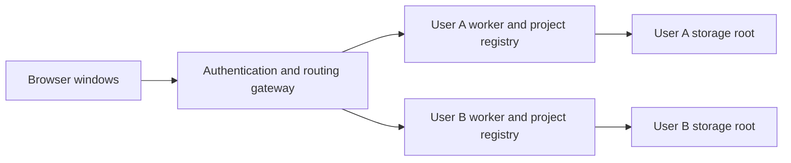

# Standalone server ownership

`server/` owns standalone configuration, embedded UI serving, per-user file
libraries, authentication and worker lifecycle. `wordflow-backend` owns analysis
and database behavior. `wordflow-api-dev` is the API-only Vite/Test host and is
not a release package. The server has single-user and Linux multi-user modes.

Single-user mode runs the same per-user host in process, under `admin`. Each host
maintains a registry of transient project UUIDs. New/Open selects a project only
in the requesting window. Different files have independent runtimes; opening
the same canonical file reuses its runtime. Project requests are captured under
`/project/{id}`. Refresh reconnects to the project ID in the browser URL.
Disconnecting a browser does not close projects or cancel accepted tasks.

Explicit Close Project closes the shared runtime in every attached window.
Editing protection, Untitled Save/Discard/Stay, cancellation confirmation and
cleanup barriers apply to Close. Failed close retains the runtime. User-scoped SSE
announces changes and each window checks its captured ID; it does not select
another window's project. Stale IDs after worker restart require explicit reopen.
Saved projects survive restart; Untitled storage remains temporary. There is no
crash recovery or change to the `.wfpj` schema.

`/api/server/events` combines project-registry and application-preference
invalidations. Preference and registry subscribers share one connection in each
browser window, keeping refresh requests available when multiple windows are open.
Project runtime events remain scoped to the captured project.

Uploads and projects retain copy-on-import, no-overwrite publication, validated
filenames and symlink rejection. A file cannot be deleted while a registry runtime
has it open. Checkpointed downloads preserve project structure and differ from
portable Export. [Storage reference](../../reference/application-storage.md)
owns exact directory, preference and credential contracts.

## Multi-user boundary

Google and CILogon Authorization Code flows use PKCE, state, nonce and validated
ID tokens. Accounts are keyed by issuer and subject, without email merging.
SQLite stores account metadata and hashed 24-hour session tokens. Login
transactions are single-use and expire after ten minutes. Mutations require the
session's CSRF token and exact configured public Origin. Session cookies are
Secure, HttpOnly and SameSite. Logout revokes only the presented session.

A dedicated Linux service account uses rootless Docker to launch one worker per
user from an immutable application image ID. Workers mount only their user's
root at `/wordflow`; the image is read-only, capabilities are dropped, privileges
cannot increase and resource limits must be enforced by cgroup v2 and systemd.
Each worker has its own Docker bridge and private Unix socket, with no published
ports, Docker socket, host home, other users' roots or authentication secrets.
The gateway streams HTTP, Arrow, SSE, uploads and downloads after authentication.
It resolves socket paths beneath the user root without symlinks and pins the
resolved socket inode, preventing worker-writable paths from redirecting requests
into another user's socket.

Gateway provisioning is serialized and bounded. Storage locks reject duplicate
workers. A restarted gateway may adopt matching healthy workers. Shutdown sends
SIGTERM and waits for cleanup without a Docker forced-kill timeout. Worker crashes
are isolated to that user and surfaced as unavailable/reopen states. There is no
idle eviction. The root-installed network policy and actual worker resource/egress
checks are mandatory deployment prerequisites; see the
[Linux deployment procedure](../../runbooks/linux-multi-user.md).

## Prefix and generated contracts

The configured external prefix is injected into `index.html`; a reverse proxy
strips it before forwarding. Assets, APIs, streams and downloads use that prefix.
Forwarded headers do not authorize Origins. Multi-user public URL must be HTTPS
and match the prefix, including each provider's explicit callback registration.

Rust annotations own OpenAPI contracts. `vp run api:generate` composes backend,
server, preference and account schemas without opening storage or loading assets.
The frontend consumes generated types. See
[server build and operation](../../runbooks/native-server.md).
