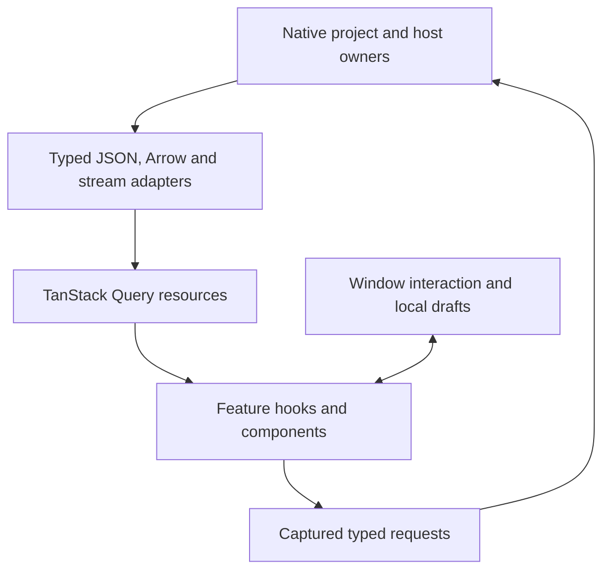

# Frontend state and data flow

TanStack Query owns native resources and their invalidation: project metadata,
Data Block schemas and pages, tabs, results, files and tasks. Rust DTOs and
Utoipa/OpenAPI own the wire contracts. Feature adapters consume the generated
TypeScript types through `api/client.ts`; Arrow IPC, streaming and downloads keep
explicit adapters. See the [frontend overview](overview.md) for component
boundaries and the [native API reference](../../reference/native-project-api.md)
for routes.

Zustand owns window interaction: active tools/tabs, graph selection, pins,
positions and drafts keyed by project API base and tab identity. Components own
local form, pagination, dialog and resizing state. These owners do not duplicate
the project database or host file registry.

## Project and host lifetime

The browser retains a Query client and interaction snapshot per open project.
Switching projects restores its selection, graph, Data View and tool drafts;
background tasks remain with their native runtime. Equal Data Block names in two
projects remain independent. Shared close releases that project's window state.
Desktop document windows discover their own runtime URL through IPC.

Host preferences and provider metadata remain outside project state. The host
adapter loads preferences before rendering and distributes confirmed updates.
Credentials follow the [application storage contract](../../reference/application-storage.md):
operation headers carry provider keys, and the LDaCA token remains in window
memory. Neither enters stored analysis requests or Query keys.

## Tabs, Run and Preview

The native tab owns its name, position and saved display settings. Its analysis
owns the captured Run request and versioned outputs. One visible native task
represents each Run. Task updates and project invalidations refresh the existing
Query resources; the renderer adds no task scheduler or persisted recovery owner.
Closing a tab cancels its run and purges associated task history. Late completion
cannot recreate a removed tab.

Forms retain local edits separately from accepted requests. Run captures the
current form. Explicit Topic Run executes downstream stages afresh; adjustment
requests go through the native retained-stage owner and reject superseded
responses. The last valid adjustment result stays visible on failure. Older saved
requests/results retain their versioned meaning until explicit Rerun.

Preview is temporary and sampled/page-scoped. Its result is retained only for the
window's current preview lifetime and does not create a published Data Block.
Changing or leaving that scope discards it. AI Preview calls the provider afresh
for the requested page and does not write source labels. Shared controls expose
Preview, Run/Rerun, Stop and Clear according to each tool's supported actions.
Help remains available while parameter editing is locked.

Execution, cancellation and durable artifact lifetime are described in
[native analyses](../backend/native-analyses.md). The frontend does not reconstruct
legacy analysis forests or child-stage task rows.

## Result projections and downloads

Results request native projections using the current filter, sort and page.
Presentation column order is saved separately from sort state. The shared
searchable metadata picker and result-column controls preserve exact source names.
Reset sort clears sorting and returns to page one.

`lib/arrow/` decodes physical Arrow fields and metadata, preserving exact integers,
decimal scale, timestamp precision and nested values. Shared type helpers provide
plain labels without changing storage. Row Details reads the source STRUCT;
generated fields remain outside it. Query errors stay with the owning panel and
retain the original diagnostic instead of becoming empty tables.

Version-2 Topics, Concordance and Quotation request exact-text joins to current
source rows. Current metadata, schema and source order therefore come from the
native projection. The renderer does not join later rows by position or retain a
second metadata snapshot. Historical versions use their historical adapters.
Topic assignments and coordinates remain fitted; current-source summaries supply
counts, shares and eligible metadata groups.

Native direct downloads project all matching pages with current filters, sorting
and selected column order, using the four shared exporters. Publication always
retains source text; download-only omission disables dependent positions. Graph
exports read committed database contents. Annotation manual drafts require Save
or Cancel before download. AI Preview exports only its completed current page
without another provider request. Its appended Arrow text vectors use explicit
validity bits, avoiding dynamic predicate compilation under desktop CSP.

## Annotation and partial Quotation

Manual Annotation uses the native Table-edit session with explicit Save/Cancel.
Window drafts affect comparisons and filters, while committed source values
remain the database's authority. AI Run commits each completed eligible batch to
the protected source Table. Clear, Stop or tab deletion does not undo those labels.
New tabs default to missing annotations; an explicit saved All rows choice stays.

Quotation refreshes committed partial batches through the existing result Query.
It keeps the current page and page size, clamping only when necessary. Reopening
reads the durable partial manifest; Resume is explicit and configuration-bound.
There is no automatic task resumption.

## Publication and shared interactions

Add to Project calls the native atomic publication owner. Published live Views
own independent hidden generated-output copies. Clearing or deleting the analysis
cannot alter them. Source binding, rename, schema invalidation and backing cleanup
remain native responsibilities; see [project semantics](../../domain/native-projects.md).

The active input-destination registry validates picker, double-click and plain
Data Block drag additions. Command-drag on macOS or Ctrl-drag elsewhere moves a
node. Graph canvas gestures and input transfer keep separate interaction owners.
Native Help delivers a window-scoped intent to the existing bundled document
viewer; its index, menu and search ownership are in [desktop architecture](desktop.md).
