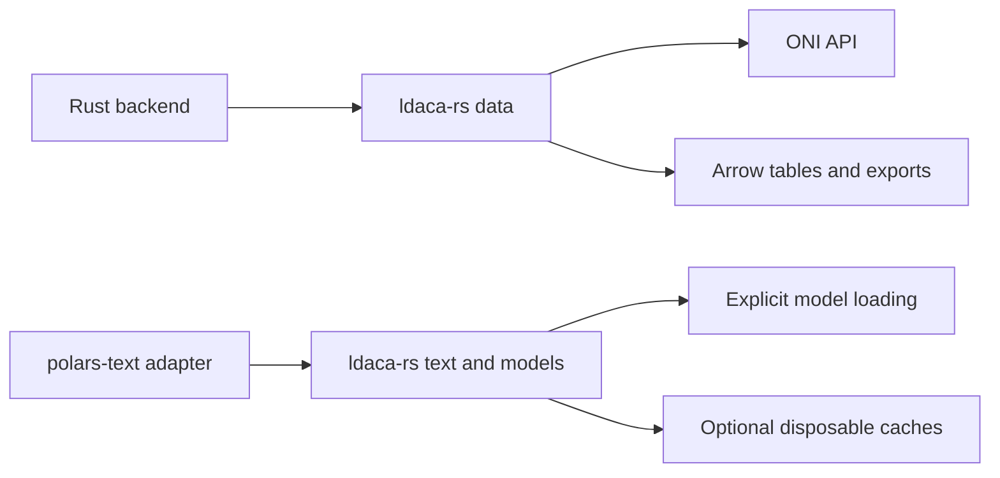

# LDaCA native library

`ldaca-rs/` is a root-tracked Rust library owning reusable text computation and
ONI data access/RO-Crate conversion. It has no Python or Polars dependency.

The core returns ordinary Rust values for text operations and Arrow tables for
imports. Text/model features and the data feature are independent. Persistent
cache entrypoints require `cache`; ordinary tokenization and embeddings do not.

The library owns cleaning/counting, tokenization, tokenizer metadata, concordance,
frequency statistics, embeddings, topic computation/projections and quotation
extraction. The Polars adapter owns Series conversion, lazy plugin registration,
Python argument validation and output schemas. Model and algorithm code has one
implementation in the core, including the formerly Python frequency statistics.
Hosts select uncapped, adaptive or fixed topic-size clustering explicitly;
Wordflow uses uncapped clustering. Projection contexts retain Unicode-character
segment spans for the adapter's per-topic document extraction.

The native backend selects the data and analysis features it needs. It owns project naming,
operation supervision, import publication and error translation. The SDK retains
bounded I/O, immutable credential views, ordered RO-Crate conversion, explicit
Wordflow import profiles, and Arrow exports. No blocking runtime-owning client or
Python SDK bindings remain. The old FastAPI LDaCA integration is outside this
cutover's compatibility boundary.

The ONI adapter owns paginated collection/member discovery and explicit strict or
replacement-with-report text decoding. The backend supervises member preparation
and atomic publication; frontend catalogue queries and window-memory credentials
remain in their established owners. The [native API reference](../../reference/native-project-api.md#desktop-imports)
records current bounds, import modes and reporting contracts.

The SDK owns no Wordflow project schema or HTTP runtime. See the [library README](../../../ldaca-rs/README.md)
for interfaces, features, offset contracts and local checks.
