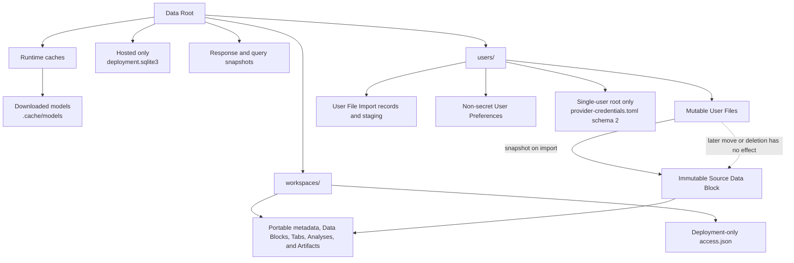

# Files And Storage

## Storage Areas

The Data Root owns one global Workspace catalogue, per-user file/import areas,
execution-private staging, response snapshots, and runtime caches. Hosted
multi-user deployments additionally own `deployment.sqlite3`; single-user
runtimes neither create nor read it. Analysis lifecycle and Artifacts live
inside their Workspace; User File Import history lives inside its user's import
area. Host paths are private and never appear in public resources.

Downloaded models live in the Data Root too, under `.cache/models/`: the
Quotation spaCy model in `spacy/`, Hugging Face tokenisers and Topic Modelling
embedders in `huggingface/`, and the CJK tokenisers' Lindera dictionaries in
`lindera/`. Whenever a Data Root opens, the runtime names these folders in
`WORDFLOW_SPACY_CACHE`, `HF_HOME` and `LINDERA_DICT_PATH` before any worker
starts. A variable the deployment set keeps its folder; the server image sets
`HF_HOME`, `LINDERA_DICT_PATH` and `XDG_CACHE_HOME`, and with `XDG_CACHE_HOME`
set the spaCy model stays in the operating system's cache for
`au.edu.ldaca.wordflow`, where the image prefetches it. Choosing another Data
Root downloads the models again into it. The application never installs the
spaCy model into its Python environment at runtime.

Earlier versions downloaded models into folders of the user's account: the
spaCy model into the operating system's cache for `au.edu.ldaca.wordflow`
(`spacy/en_core_web_md`), Lindera dictionaries into `$HOME/.cache/ldaca`, and
Hugging Face models into `~/.cache/huggingface/hub`. When a Data Root opens,
those downloads come into it once. Wordflow's own folders move: the spaCy
model, the Lindera dictionaries and the compiled Core ML models
(`hub/coreml`). Across disks the first two are copied and the originals
removed, and the Core ML models are removed and rebuild on use. The Hugging
Face cache is shared with other programs, so only Wordflow's models there
(`bert-base-uncased` and the two Topic Modelling embedders) come in, as hard
links where the disk allows and copies otherwise, and the originals stay. A
folder that can't be read is skipped and its model downloads again; nothing
already in the Data Root is replaced.

A User File is mutable import material. Adding one to a Workspace snapshots it
into an immutable Workspace-owned source, so later moves or deletion in the
user file area cannot rewrite an existing Source Data Block.

File preview is a value-inspection contract, not a promise of the eventual
Source Data Block schema. CSV and TSV preview pages and schemas expose every
field as raw text, preserving lexemes such as `001`. JSON, JSONL, and NDJSON
preview types come from full-file inference. When a Source Data Block is
created, all five row-oriented formats use full-file inference before canonical
dtype normalization and immutable Parquet staging; a numeric CSV lexeme such as
`001` may therefore be stored as integer `1`.

The User File area accepts arbitrary regular files. Loadability is a separate
property derived from one backend-owned, case-insensitive extension allowlist.
The complete User File tree therefore includes assets such as images even
though the Data Loader presents only Loadable User Files and their directories.

Every user area may contain non-secret User Preferences. Only the canonical
single-user `root` area may contain the separate write-only
`provider-credentials.toml` schema 2, containing named Annotation Provider
Configurations and the independent Data Portal token. Multi-user personal
configurations and Provider Credentials are browser-owned and never part of the
backend storage model.

## Safety Invariants

- User-controlled paths cannot be absolute, traverse parents, use Windows
  drive/UNC syntax, pass through links/reparse points, or escape their owner.
- Uploads and archive imports are bounded independently of `Content-Length`.
- Files publish through same-filesystem temporary files and atomic replacement.
- Existing destinations are not overwritten implicitly.
- User File collection reads return one complete tree, directories before
  files at every level, ordered by Unicode case-folded name and exact relative
  path. A configured serialized-response byte bound fails the whole read rather
  than introducing pagination or truncation.
- Every file resource reports whether it is loadable. Directories and files
  outside the canonical extension allowlist report `loadable: false` without
  being deleted, rejected at upload, or removed from the complete API tree.
- Loadable ZIP files are inspected without extraction under the same
  compression-ratio, path, encryption, and file-kind rules used for ZIP-based
  spreadsheets. Safe members that decode as strict
  UTF-8 become one document row each; undecodable members are ignored.
- Downloads stream response-owned snapshots so concurrent source mutation
  cannot truncate an accepted response.
- Workspaces with a recognized `data_schema_version` mismatch can be preserved
  in a bounded raw ZIP without deployment-only `access.json`; this does not
  relax the strict load or portable-import gates. Old layouts such as native
  schema 23 receive no format-specific download treatment.
- Workspace archives are inspected and extracted into staging before
  publication. The remaining crash window around final publication and plan
  rebasing is tracked in the
  [persistence-integrity reference](../reference/persistence-integrity.md).
- Workspace discovery is a fresh scan of the global catalogue; exact
  `access.json` ownership is checked before portable content is exposed.
- Archive exports omit deployment ownership, and imports reject embedded
  ownership before generating a new sidecar for the importer.
- Portable Workspace archive data format 1 contains materialized Data Blocks,
  compatible terminal Analysis forests, declared Artifacts, and materialized
  immutable query inputs. It contains no serialized executable plans. Import
  assigns a fresh Workspace identity, rebuilds and rebases the private lazy
  plans, and rejects an unsupported data version. Newer Analysis-kind versions
  and their dependent files are omitted with response-header counts instead of
  blocking compatible data.
- One `QuotaService` owns total allocated-byte policy and usage snapshots for
  every principal. `StorageAdmissionService` applies that policy to Workspace,
  User File, import, Analysis, and response-snapshot writes. User Preferences
  and single-user Provider Credential writes do not yet use that admission
  boundary.
- A hosted finite policy is read from SQLite for every status or admitted-write
  check; `NULL` is unlimited. Single-user mode uses a fixed database-free
  unlimited policy. Unlimited policies perform no quota scan or accounting
  probe.
- Finite quota accounting requires host filesystem allocation metrics. A
  multi-user runtime fails readiness when the host cannot provide them, while
  the unlimited single-user desktop profile never requests that capability.
- Finite usage is a fresh filesystem-allocation scan of the principal's user
  area plus live and trashed Workspaces attributed by `access.json`. It uses
  allocated blocks with a one-allocation-unit floor for every regular file and
  directory, and persists no usage counter or ledger.
- In-process reservations prevent admitted concurrent writes from
  overcommitting a finite limit. Their staged output is measured and the
  current SQLite policy is checked again before atomic publication.
- Quota admission precedes the separate Data Root free-space reserve. Quota
  failures return `storage_quota_exceeded` with the four allocation values;
  shared capacity failures return `storage_capacity_exceeded` without host
  details. Reads, deletion, and zero-growth changes remain available while a
  principal is over quota.
